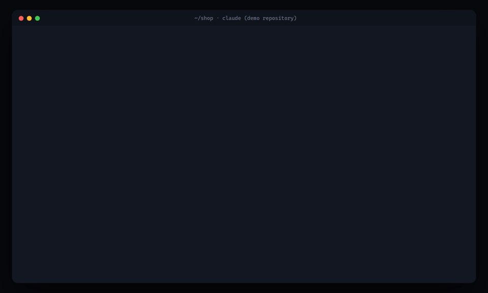

# Twice Shy

**Chat échaudé craint l'eau froide.** Ton agent ne refera pas un bug que ton dépôt a déjà corrigé.

*[English](README.md) · Français*

Twice Shy est un plugin pour [Claude Code](https://docs.claude.com/en/docs/claude-code). Il lit les bugs que ton
dépôt a déjà corrigés, en tire des règles, **teste chaque règle sur des bugs récents qu'elle n'a jamais vus**, puis
vérifie le travail de l'agent chaque fois qu'il dit « fini ». Si quelque chose ne va pas, l'agent est renvoyé
corriger avec l'erreur exacte et la ligne en cause, avant que tu ne voies quoi que ce soit.

<p align="center"></p>
<p align="center"><sub>Sur un petit dépôt de démonstration. Les sorties de Twice Shy sont réelles ; l'erreur de l'agent a été tapée à
la main, car sur un dépôt aussi petit l'agent a trouvé la bonne solution tout seul.</sub></p>

## Pourquoi

Les agents disent souvent « corrigé, les tests passent ». Parfois, ils ne les ont pas lancés. Parfois, ils
réintroduisent un bug que l'équipe a corrigé il y a trois mois, parce que rien dans le code ne dit pourquoi il était
écrit comme ça.

Lancer les tests quand l'agent s'arrête, beaucoup de hooks le font déjà, et Twice Shy aussi. Ce qui compte, c'est le
reste : **des règles tirées de ton propre historique, dont l'efficacité est mesurée.**

## Est-ce que ça marche ?

Mesuré sur des dépôts open source : règles apprises sur les correctifs anciens, puis testées sur les 12 plus
récents, que les règles n'avaient jamais vus :

| Dépôt | Langage | Bugs récents que les règles gardées auraient détectés |
|---|---|---|
| [spf13/cobra](https://github.com/spf13/cobra) | Go | 5 sur 12 |
| [pallets/click](https://github.com/pallets/click) | Python | 2 sur 12 |

Environ deux minutes et 1,25 $ au tarif de l'API par passage. Ces chiffres varient d'un passage à l'autre : le juge
est un modèle de langage.

## Comment ça marche

**`/twiceshy:learn`** (une fois, puis quand tu veux)

1. Retrouve les correctifs de bugs dans tes 400 derniers commits : `fix:` et ses variantes, en anglais ou en
   français. Si l'équipe ne les étiquette pas, un modèle rapide lit les messages de commit et désigne ceux qui
   réparent un bug.
2. **Coupe l'historique en deux.** Les correctifs anciens servent à écrire les règles ; les plus récents sont mis
   de côté pour les tester. Une règle n'est jamais notée sur le bug dont elle vient.
3. Teste chaque règle sur chaque correctif mis de côté, dans les deux sens :
   - avant le correctif, le code était faux : la règle l'aurait-elle signalé ? (bug détecté)
   - après le correctif, le code est juste : la règle le signalerait-elle quand même ? (fausse alerte)
4. Les règles qui ne détectent rien ou qui crient au loup sont réécrites une fois, puis retestées. Toujours
   inutiles : supprimées.
5. Enregistre celles qui restent dans `.twiceshy/rules.json`, avec leur score. Commite ce fichier : toute
   l'équipe a les mêmes règles.

**Le hook `Stop`** (chaque fois que l'agent dit qu'il a fini)

1. Rien n'a changé depuis la dernière vérification réussie : l'agent s'arrête, rien n'est lancé.
2. Lance les vérifications du projet (types, lint, tests), détectées d'après le dépôt.
3. Demande à un juge si les lignes modifiées enfreignent une règle qui concerne les fichiers touchés.
4. Un échec : l'agent est renvoyé avec la sortie et la ligne, et il corrige.
5. Trois échecs de suite, ou un agent qui s'arrête sans rien avoir changé : Twice Shy le laisse s'arrêter et te dit
   en une ligne ce qui reste en échec. Il ne tourne jamais en boucle.

## Installation

Il faut [Claude Code](https://docs.claude.com/en/docs/claude-code), `git` et Node.js 18 ou plus.

Dans Claude Code :

```
/plugin marketplace add jodevweb/twiceshy
/plugin install twiceshy@twiceshy
```

Redémarre Claude Code, ouvre ton projet, puis :

```
/twiceshy:learn
```

C'est tout. À partir de là, chaque fois que l'agent s'arrête, Twice Shy vérifie son travail.

## Commandes

| Commande | Ce qu'elle fait |
|---|---|
| `/twiceshy:learn` | Apprend des règles à partir des anciens correctifs et les teste. Quelques minutes. |
| `/twiceshy:status` | Affiche les règles, leur score et les vérifications lancées à chaque arrêt. |
| `/twiceshy:check` | Vérifie les modifications en cours tout de suite, sans attendre que l'agent s'arrête. |

Les mêmes commandes marchent hors de Claude Code : `node <dossier du plugin>/bin/twiceshy.mjs learn|status|check`.

## Langages

Les règles sont jugées sur des diffs : elles marchent pour tous les langages. Les vérifications sont détectées
d'après les fichiers du projet :

| Stack | Vérifications détectées |
|---|---|
| Node / TypeScript | scripts `typecheck`, `lint`, `test` (npm, pnpm, yarn, bun) |
| Python | `ruff`, `mypy` s'ils sont configurés, `pytest` (uv, poetry) ou `manage.py test` pour Django |
| Go | `go vet ./...`, `go test ./...` |
| Rust | `cargo test` |
| PHP | `composer test`, `php artisan test`, `phpunit` |
| Java / Kotlin | Maven, Gradle |
| Ruby, Elixir | `rspec`, `mix test` |

Autre chose, ou un monorepo : déclare tes vérifications toi-même (voir plus bas).

## Configuration

Facultative. `.twiceshy/config.json` :

```json
{
  "gates": ["pnpm typecheck", "pnpm test --run"],
  "model": "sonnet",
  "maxAttempts": 3,
  "gateTimeoutSeconds": 300,
  "enabled": true
}
```

- `gates` remplace les vérifications détectées.
- `model` est le modèle qui écrit et juge les règles.
- `enabled: false` coupe le hook pour ce dépôt sans rien désinstaller.

## Coût et confidentialité

Twice Shy n'a ni serveur ni clé API. Il appelle le `claude` déjà connecté sur ta machine. Avec un abonnement Claude,
c'est compris dans ton usage. `learn` affiche ce que le passage coûterait au tarif de l'API : autour d'un dollar sur
un dépôt classique. Chaque vérification à l'arrêt est un appel, seulement quand du code a changé.

Ton code va au même endroit que lorsque tu utilises Claude Code, et nulle part ailleurs.

## Limites

- Le juge est un modèle de langage : il peut se tromper. C'est pour ça que chaque règle est notée sur de vrais bugs
  avant d'être gardée, et que la note est affichée.
- Un dépôt avec peu de correctifs dans son historique aura peu de règles. Les vérifications tournent quand même.
- Si tes tests échouaient déjà avant que l'agent commence, Twice Shy arrête de bloquer dès que l'agent s'arrête
  sans rien changer, et te prévient.

## Feuille de route

- Apprendre de tes propres corrections : ce que tu retouches à la main après un agent devient une règle, testée
  d'abord sur l'historique.
- ADR (Architecture Decision Records) : transformer les ADR existants en règles vérifiées, rédiger l'ADR quand un
  agent prend une vraie décision d'architecture, signaler les ADR que le code ne respecte plus.
- Une GitHub Action qui fait la même chose sur chaque pull request.

## Licence

MIT
