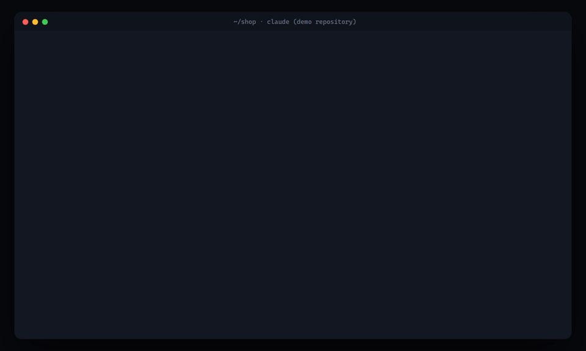

# Twice Shy

**Once bitten, twice shy.** Your coding agent won't repeat a mistake your project already paid for.

*English · [Français](README.fr.md)*

Twice Shy is a [Claude Code](https://docs.claude.com/en/docs/claude-code) plugin. It learns what your project
expects from three places: **the bugs you already fixed, the corrections you keep giving your agents, and the
decisions you wrote down** (ADRs, `CLAUDE.md`). It tests every rule before keeping it. Then, each time the agent
says "done", it runs your checks and those rules on the change, and sends the agent back until they pass.

<p align="center"></p>
<p align="center"><sub>On a small demo repository. Twice Shy's output and the agent's ADR are real; the money bug was typed by
hand, because on a repository this small the agent got it right on its own.</sub></p>

## Why

You told the agent "use the service, not fetch" last week. Today's agent doesn't know. Your `CLAUDE.md` says
"amounts in cents"; nothing checks it. An ADR explains why you picked a library; the agent adds another one for the
same job, and nobody writes down why.

Agents start every session from zero. Twice Shy is the memory that checks.

## Where the rules come from

| Source | What it reads | A rule is kept if… |
|---|---|---|
| **Your past bugs** | Bug fixes in your last 400 commits | it would have caught at least one recent bug it never saw |
| **Your corrections** | Your messages in past Claude Code sessions of this project ("no, do it like this") | it doesn't flag healthy code |
| **Your decisions** | ADRs, `CLAUDE.md`, `AGENTS.md`, and any document you list | the code still follows it; otherwise it is reported as **stale** |

Sources are modules (`src/sources/`): adding one, such as pull request review comments, does not touch the rest.

Every rule, whatever its source, goes through the same test:

- on **recent bug fixes it never saw**: would it have flagged the code before the fix? (bug caught)
- on **recent healthy commits**: would it flag them anyway? (false alarm)

Rules from bugs must prove themselves; rules you asked for only have to stay quiet on healthy code; written
decisions that recent commits no longer follow are not enforced but reported, because the document may be the one
that's wrong.

## Does it work?

Rules learned from older fixes, tested on the most recent ones, which they had never seen:

| Repository | Language | Recent bugs the kept rules would have caught |
|---|---|---|
| [spf13/cobra](https://github.com/spf13/cobra) | Go | 3 to 5 of 12, depending on the run |
| [pallets/click](https://github.com/pallets/click) | Python | 2 of 12 |

On a young project, history is thin: a 22-commit project gave no rule from bugs, but 14 rules from its owner's
corrections and `CLAUDE.md`. That is why there is more than one source.

Numbers vary from one run to the next: the judge is a language model, and every score is shown so you can see it.

## On every stop

1. Nothing changed since the last successful check: the agent stops, nothing runs.
2. Your project's checks (types, lint, tests) run, detected per sub-project (`server/`, `web/`, `packages/*`), and
   only for the sub-projects the change touches.
3. A judge reads the changed lines against the rules that apply to the changed files.
4. **The agent added a dependency** and the repository has an ADR folder: it must write the ADR (why this library,
   and why not what the project already uses) before it can stop.
5. Anything fails: the agent is sent back with the output, the line, and where the rule comes from ("from ADR-0004",
   or your own words). It fixes it.
6. Three failed attempts, or the agent stops without changing anything: Twice Shy lets it stop and tells you in one
   line what is still failing. It never loops forever.

## Install

You need [Claude Code](https://docs.claude.com/en/docs/claude-code), `git` and Node.js 18+.

```
/plugin marketplace add jodevweb/twiceshy
/plugin install twiceshy@twiceshy
```

Restart Claude Code, open your project, then:

```
/twiceshy:learn
```

From now on, every time the agent stops, Twice Shy checks its work. Commit `.twiceshy/rules.json`: your team gets
the same rules.

## Commands

| Command | What it does |
|---|---|
| `/twiceshy:learn` | Learns rules from your bugs, corrections and decisions, and tests them. Two or three minutes. |
| `/twiceshy:status` | Rules by source, their scores, stale decisions, and the checks run on every stop. |
| `/twiceshy:check` | Checks the current changes now, without waiting for the agent to stop. |
| `/twiceshy:adr` | Lists your ADRs and the ones the code no longer follows. `/twiceshy:adr init` creates `docs/adr/` with a template. |

The same commands work outside Claude Code: `node <plugin folder>/bin/twiceshy.mjs learn|status|check|adr`.

## Languages

Rules are judged on diffs, so they work in any language. Checks are detected from the project files, at the root
and in sub-projects:

| Stack | Detected checks |
|---|---|
| Node / TypeScript | `typecheck`, `lint`, `test` scripts (npm, pnpm, yarn, bun) |
| Python | `ruff`, `mypy` when configured, `pytest` (uv, poetry) or Django's `manage.py test` |
| Go | `go vet ./...`, `go test ./...` |
| Rust | `cargo test` |
| PHP | `composer test`, `php artisan test`, `phpunit` |
| Java / Kotlin | Maven, Gradle |
| Ruby, Elixir | `rspec`, `mix test` |

New dependencies are detected in `package.json`, `composer.json`, `requirements*.txt`, `pyproject.toml`, `go.mod`,
`Cargo.toml` and `Gemfile`.

## Configuration

Optional. `.twiceshy/config.json`:

```json
{
  "gates": ["pnpm typecheck", { "command": "pytest -q", "dir": "server" }],
  "documents": ["docs/conventions.md", "CONTRIBUTING.md"],
  "sources": { "corrections": false },
  "adr": "auto",
  "model": "sonnet",
  "maxAttempts": 3,
  "gateTimeoutSeconds": 300,
  "enabled": true
}
```

- `gates` replaces the detected checks. A check with a `dir` runs in that folder, only when the change touches it.
- `documents` adds your own written rules to the decisions source.
- `sources` turns a source off.
- `adr`: `"auto"` asks for an ADR on new dependencies when the repository has an ADR folder; `true` always; `false`
  never.
- `enabled: false` turns the hook off for this repository without uninstalling anything.

## Cost and privacy

Twice Shy has no server and no API key. It calls the `claude` CLI already signed in on your machine, with a short
system prompt and none of your global settings, skills or MCP servers, which keeps each call cheap. With a Claude
subscription it is part of your usage; `learn` prints what the run would cost at API prices.

It reads your past Claude Code sessions **for this project only**, on your machine, and sends excerpts of your
messages to the same Claude you already use. Turn it off with `"sources": { "corrections": false }`.

## Limits

- The judge is a language model: it can be wrong. That is why rules are tested before they are kept, and why the
  scores are shown.
- A rule from your corrections may describe a preference that only made sense once. It is dropped if it flags
  healthy code; otherwise delete it from `.twiceshy/rules.json`.
- If your tests were already failing before the agent started, Twice Shy stops blocking once the agent stops
  without changing anything, and tells you.

## Roadmap

- More sources: pull request review comments, the lines you rewrite by hand after an agent.
- A GitHub Action that does the same on every pull request.

## License

MIT
